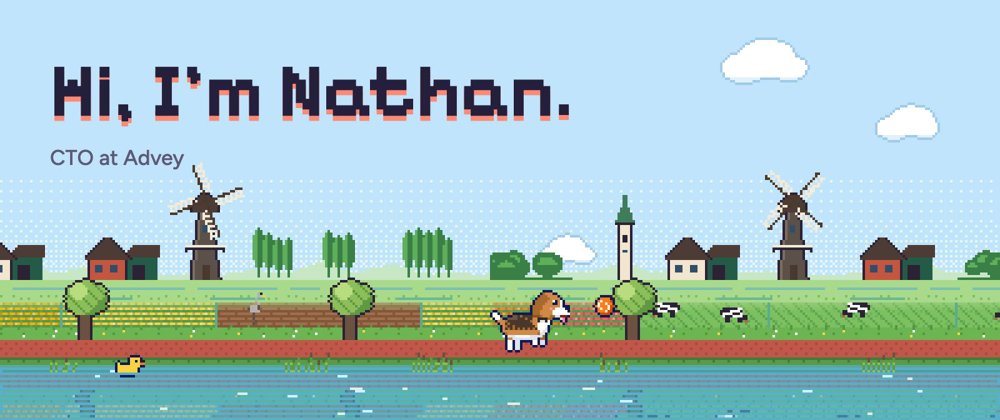
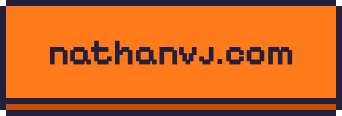
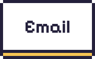
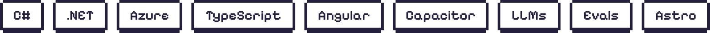
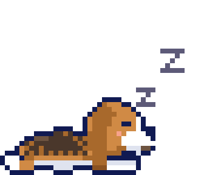

<a href="https://nathanvj.com">
  <picture>
    <source media="(prefers-color-scheme: dark)" srcset="assets/banner-night.png">
    
  </picture>
</a>

  <a href="https://nathanvj.com"><picture><source media="(prefers-color-scheme: dark)" srcset="assets/btn-site-night.png"></picture></a>&nbsp;&nbsp;
  <a href="https://www.linkedin.com/in/nathan-van-jole"><picture><source media="(prefers-color-scheme: dark)" srcset="assets/btn-linkedin-night.png"></picture></a>&nbsp;&nbsp;
  <a href="https://twitter.com/nathanvanjole"><picture><source media="(prefers-color-scheme: dark)" srcset="assets/btn-x-night.png"></picture></a>&nbsp;&nbsp;
  <a href="mailto:hi@nathanvj.com"><picture><source media="(prefers-color-scheme: dark)" srcset="assets/btn-email-night.png"></picture></a>

<h3><picture><source media="(prefers-color-scheme: dark)" srcset="assets/heading-stack-night.png"></picture></h3>

<picture><source media="(prefers-color-scheme: dark)" srcset="assets/chips-night.png"></picture>

 

<picture><source media="(prefers-color-scheme: dark)" srcset="assets/terminal-night.svg"></picture>

Most of what I build lives in private repos. The exception is [my site](https://github.com/nathanvj/nathanvj.github.io): Ruby, the polder and Ruby Run, in plain TypeScript on a canvas. Open the terminal there and type `help`.

 

  <picture><source media="(prefers-color-scheme: dark)" srcset="assets/ruby-night.png"></picture>
   
  Made in the Netherlands, with Ruby and ♥

